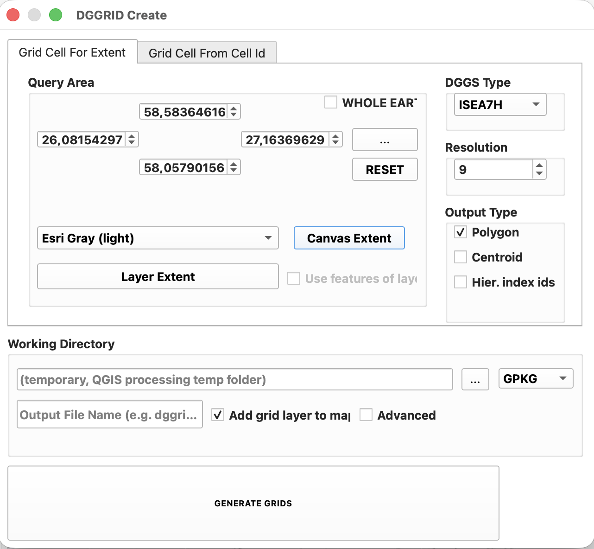
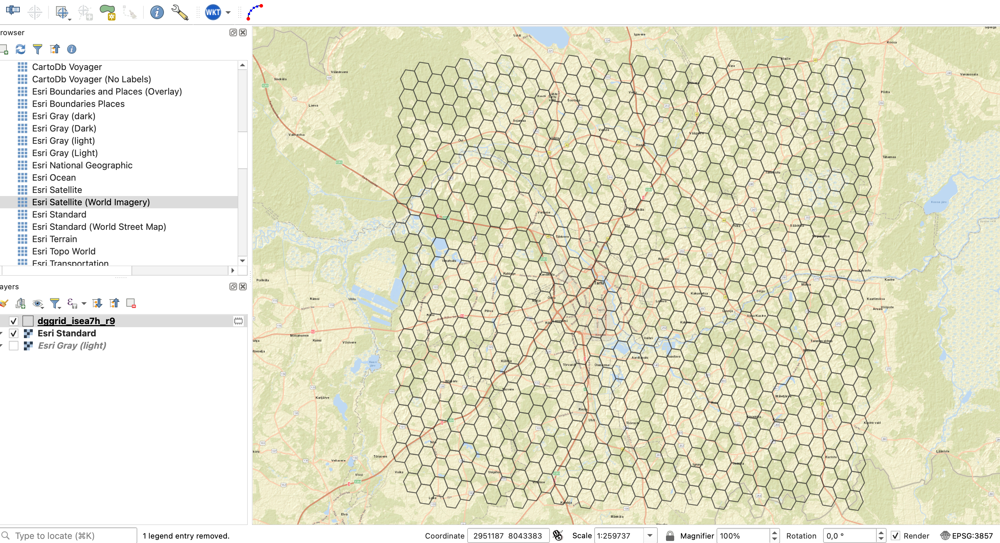
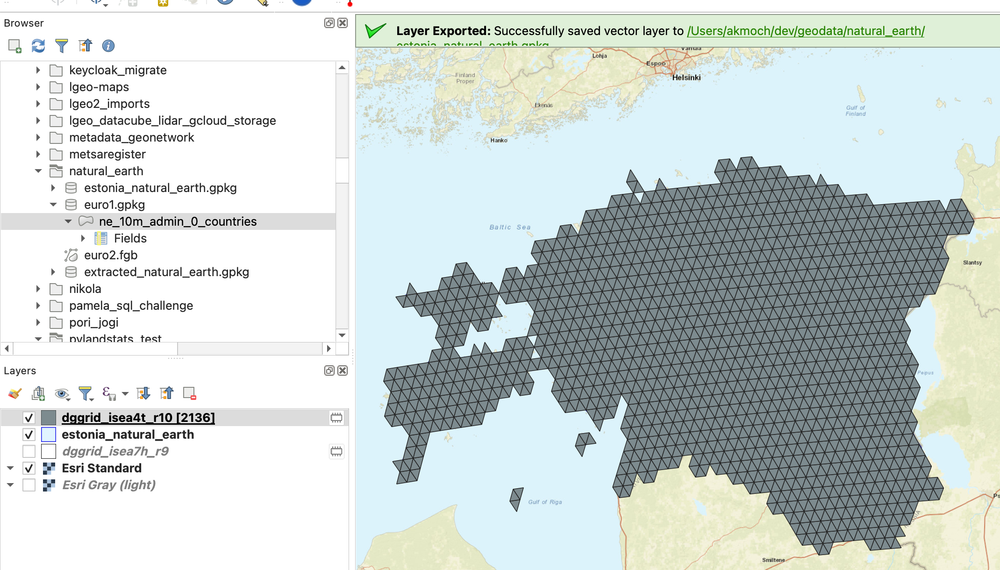
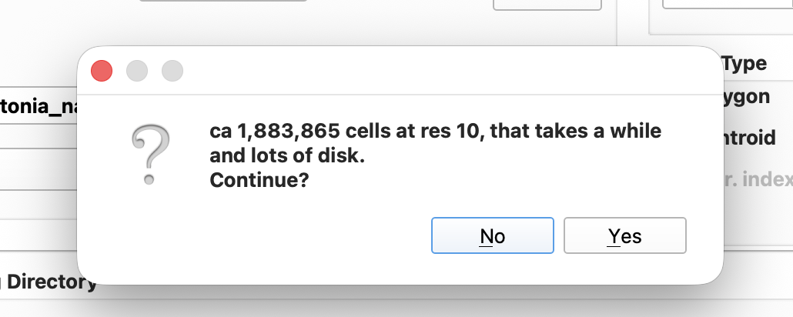
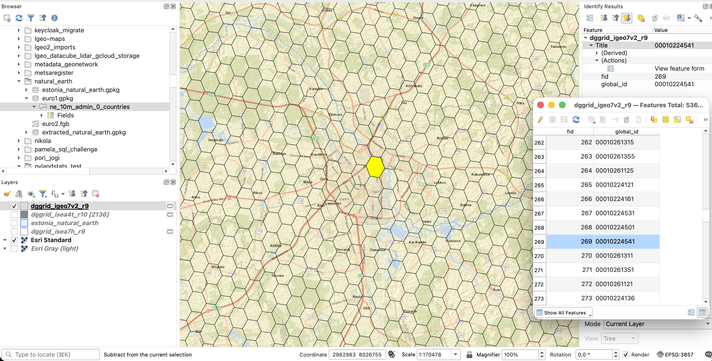
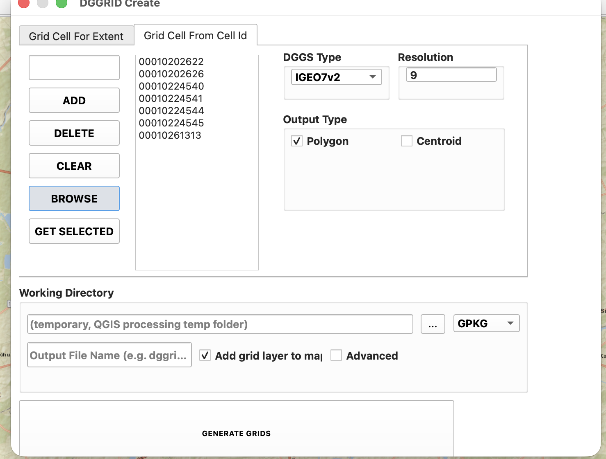
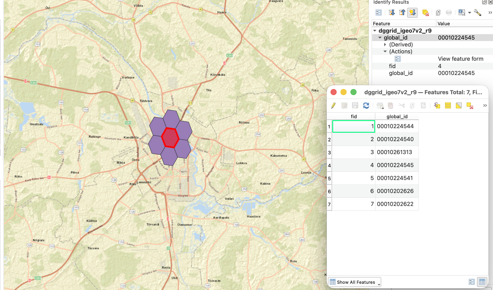
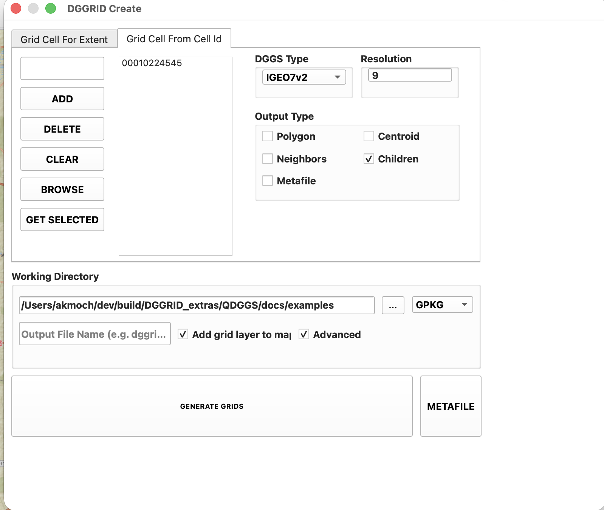
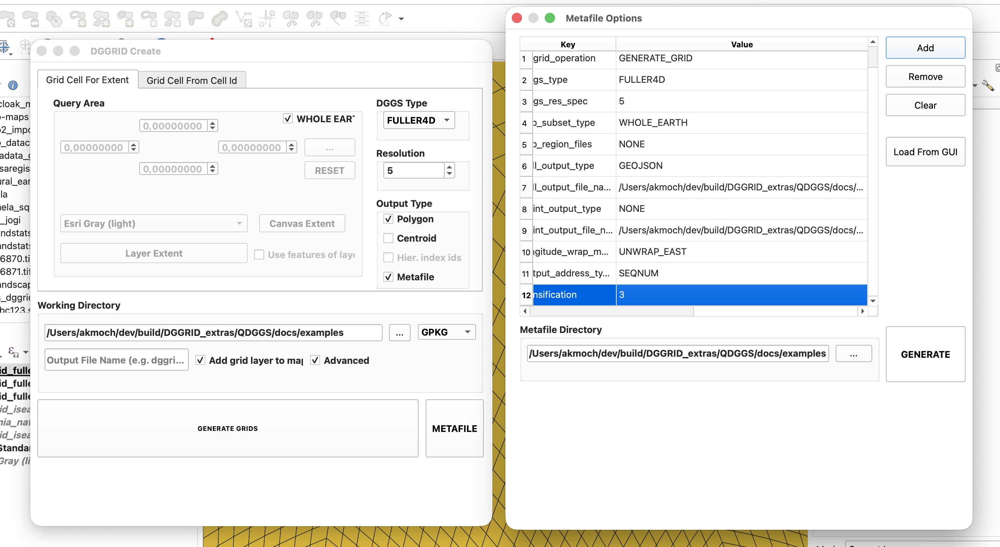

# DGGRID Create, tutorial

This tutorial walks through five typical uses of the plugin: (1) a plain grid for the map extent, (2) a grid clipped by the polygons of a layer, (3) IGEO7v2 cells with hierarchical cell ids, (4) IGEO7v2 cells generated from a file of cell ids, and (5) a run with a custom DGGRID metafile. The examples use Estonia and the city of Tartu, but any area works the same way. Installation, grid types and output files are described in the [user guide](README.md).

## Before you start

Open the plugin with its toolbar icon or via Plugins → DGGRID Create. On first start, the plugin offers to download DGGRID; confirm, and the dialog opens with all grid types available. The dialog has two tabs, Grid Cell For Extent and Grid Cell From Cell Id, and a Working Directory section below them that is shared by both tabs.

You can leave the Working Directory empty for these examples. The results then go to the QGIS temporary folder, which is deleted when QGIS closes. Add grid layer to map is ticked by default, so every result appears as a new layer.

## 1. ISEA7H cells for the map extent

The simplest case is a grid for the area that is currently visible on the map. The cells get sequential ids (SEQNUM), which is sufficient for most mapping and aggregation tasks:

1. zoom the map to the area of interest (e.g. Tartu);
2. in the tab Grid Cell For Extent, select DGGS Type ISEA7H and Resolution 9 (cells of ca 1.3 km²);
3. press Canvas Extent, which fills the Query Area with the map extent in longitude and latitude;
4. keep Polygon ticked, and tick Centroid if you also want the cell centre points;
5. press GENERATE GRIDS.

The result is a layer `dggrid_isea7h_r9` with one polygon per cell and the SEQNUM in the field `global_id`. Instead of the map extent, Layer Extent takes the extent of the layer selected in the Query Area list, and the `...` button lets you draw a rectangle on the map.

## 2. ISEA4T triangles clipped by a polygon layer

DGGRID can clip the grid by arbitrary polygons, not only by a rectangle. In this example, we use a triangle grid and a boundary layer of Estonia (any polygon layer works, in any coordinate reference system):

1. load the polygon layer into the QGIS project;
2. select DGGS Type ISEA4T and Resolution 10;
3. select the layer in the Query Area list and tick Use features of layer;
4. press GENERATE GRIDS.

The plugin reprojects the polygons to WGS84 before DGGRID clips the grid, so the cells follow the boundary rather than the bounding box of the layer. Before a large run, the plugin estimates the number of cells and asks whether to continue; you can try this by increasing the resolution to 15. UBER H3 can be used in the same way, and on first use the plugin offers to install the `h3` package.

## 3. IGEO7v2 cells with hierarchical cell ids

For grids with a hierarchical index, the cell ids can encode the position of the cell in the grid hierarchy. This is required if you want to use the cells later as input for the tab Grid Cell From Cell Id:

1. zoom the map to Tartu and press Canvas Extent;
2. select DGGS Type IGEO7v2 and Resolution 9;
3. tick Hier. index ids (this checkbox is only enabled for grids with a hierarchical index);
4. press GENERATE GRIDS.

The field `global_id` now contains Z7 digit strings such as `00010224545`, where the first two digits are the base cell and each further digit is one resolution level. A cell and its children share the same prefix, so the children of `00010224545` at resolution 10 are `000102245450` to `000102245456`. To continue with a few of these cells, select them on the map and press GET SELECTED in the tab Grid Cell From Cell Id, which copies their ids and the grid type into the list.

## 4. IGEO7v2 cells from a list of cell ids

Cell ids from another source (e.g. a table, a database query or another DGGS tool) can be turned into cell polygons directly. The example file [`examples/igeo7v2_tartu_r9.txt`](examples/igeo7v2_tartu_r9.txt) contains a cell in Tartu and its six neighbours:

1. open the tab Grid Cell From Cell Id and select DGGS Type IGEO7v2;
2. press BROWSE and select the file;
3. check that the list contains the ids and that Resolution shows 9 (it is taken from the length of the ids);
4. press GENERATE GRIDS.

The file can contain one id per line, or ids separated by commas or spaces, and lines starting with `#` are skipped. A CSV file with a single id column also works, because the header is ignored. However, the plugin reads every number in the file, so remove other numeric columns first, and keep the ids as text: spreadsheet programs tend to drop the leading zeros, which turns `00010224545` into a different id. Single ids can also be typed into the field next to ADD.

### Neighbours and children

The tab Grid Cell From Cell Id can also compute the neighbours and the hierarchical children (7 per cell for Z7) of the listed cells. These options are hidden until you tick Advanced in the Working Directory section. For DGGRID grids this takes two runs, because DGGRID writes the neighbours and children as lists of ids, not as cells:

1. choose a Working Directory, so that the text files are easy to find (the temporary folder is not);
2. tick Advanced, then tick Neighbors or Children (and untick Polygon if you only need the ids);
3. press GENERATE GRIDS, which writes a text file `nbr_...txt` or `chd_...txt` to the Working Directory;
4. press BROWSE and select this text file, which replaces the list with the new ids (and sets the resolution, e.g. 10 for the children);
5. press GENERATE GRIDS again to create the cells.

For UBER H3, the neighbours and children are added as layers directly in the first run, so the second run is not needed. The neighbours and children of the DGGRID grids are only available for the grids with a hierarchical index, which are the only DGGRID grids in this tab.

## 5. Custom metafiles

DGGRID is controlled by a metafile, a plain text file with one parameter per line, and the plugin writes such a metafile for every run. DGGRID offers many more parameters than the dialog shows (e.g. other output formats, densified cell edges or different grid orientations). For these cases, the metafile can be edited before the run:

1. tick Advanced and set up the dialog as for a normal run (e.g. as in example 1);
2. press METAFILE, which opens the window Metafile Options with the parameters of the current settings (Load From GUI refreshes them after changes in the main dialog);
3. edit values or add rows with Add (e.g. `cell_output_type` `GEOJSON`, or a new row `densification` `3`);
4. press GENERATE.

DGGRID then writes its output exactly as defined in the table, and the plugin does not convert or load the result; add it to the map via Layer → Add Layer or the Browser panel. Alternatively, tick Metafile in the Output Type box (visible with Advanced) to keep the metafile of a normal run, and run it later with DGGRID on the command line. All parameters are described in the [DGGRID documentation](https://dggrid.readthedocs.io/), in particular in the [DGGRID manual](https://dggrid.readthedocs.io/v9.15/dggrid_manual.html).

